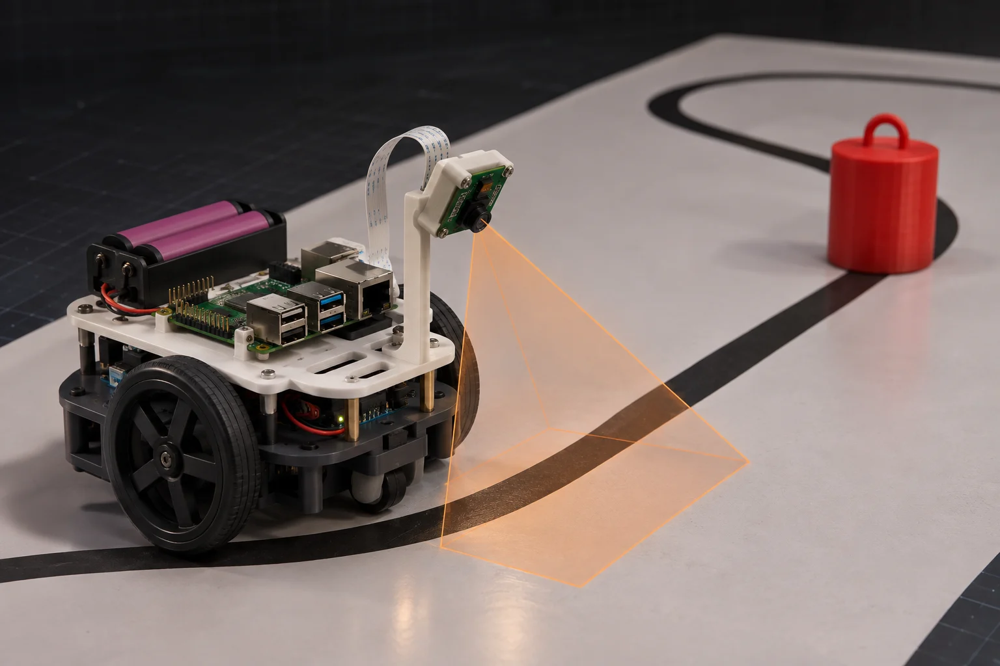

# Reto 3 · Seguimiento de línea y evasión de obstáculos con visión

**Actuadores y Sensores — Universidad EAFIT, 2026-2** · Profesor: Felipe Mendoza Giraldo
David Zuluaga Henao · Alejandro Nanclares · Nicolás Zapata Jurado

El robot XRP sigue la línea y esquiva los cilindros rojos usando **solo la cámara de la Raspberry Pi**.
La Pi procesa la imagen y decide; el XRP solo recibe por serial (USB) la potencia de cada rueda.

```
Cámara ──imagen──▶ Raspberry Pi (visión + decisión) ──"izq,der\n" por USB──▶ XRP ──▶ motores
```

🌐 **Sitio con el simulador 3D:** https://reto3-xrp-vision.vercel.app
📄 **Informe:** [docs/Informe_Reto3_Actuadores_y_Sensores.pdf](docs/Informe_Reto3_Actuadores_y_Sensores.pdf)

> **La cámara debe ir alta.** En la prueba real el robot se armó con una webcam USB al frente, a ~4,5 cm del piso, y así
> pierde la línea en las curvas cerradas. Con el mismo programa, la cámara alta (17 cm, 52° hacia abajo) completa 6/6 vueltas
> sin obstáculos y 10/12 con cilindros en simulación; la cámara baja, 0/6 y 0/12. La página tiene los **dos simuladores 3D**,
> uno debajo del otro, para comparar los montajes.

**Qué va en cada placa:** en el **XRP** solo [`xrp/main.py`](xrp/main.py) (guardado como `main.py` en su raíz);
en la **Raspberry Pi** toda la carpeta [`raspberry/`](raspberry) (se ejecuta `python3 reto3.py`).



## Simulador 3D en el navegador

[`web/`](web) es el sitio del reto. Su simulador 3D (Three.js) pone el robot en la pista del Reto 1 a
escala real, con luces y sombras, piso de baldosas y cilindros rojos con manija. La cámara virtual del
robot tiene la misma óptica y montaje que la real, y **cada imagen que renderiza pasa por el mismo algoritmo
de visión y control** de la Raspberry Pi, portado a JavaScript (`web/js/robot/`) y verificado contra la
versión en Python con las mismas imágenes (mismos puntos de la línea con ±0,1 cm y la misma posición del
cilindro). Se ve en tercera persona (persecución, lateral, órbita, superior) y en primera persona (la
imagen de la cámara con la detección, las máscaras y la vista de pájaro en cm).

Para verlo localmente: `python -m http.server 8000 --directory web` y abrir `http://localhost:8000`.
Los parámetros y la pista se exportan desde Python con `python web/herramientas/exportar_datos.py`.

## Archivos

| Archivo | Qué hace |
|---|---|
| [`xrp/main.py`](xrp/main.py) | Programa del XRP (guardarlo como `main.py`). Recibe comandos, compensa los motores, se detiene si no llegan comandos en 0,5 s, avisa `BTN` al presionar el botón. **No usa ningún sensor.** |
| [`raspberry/reto3.py`](raspberry/reto3.py) | Programa principal de la Pi. |
| [`raspberry/config.py`](raspberry/config.py) | **Todos los parámetros** (montaje de la cámara, umbrales, velocidades, evasión). |
| [`raspberry/vision.py`](raspberry/vision.py) | Detección de la línea y del cilindro rojo. |
| [`raspberry/geometria.py`](raspberry/geometria.py) | Píxel ↔ centímetros sobre el piso (cámara estenopeica u homografía). |
| [`raspberry/control.py`](raspberry/control.py) | Máquina de estados: seguir, buscar, frenar, retroceder, evadir, meta. |
| [`raspberry/piloto.py`](raspberry/piloto.py) | Une visión y control; lo usan el robot y el simulador (mismo código). |
| [`raspberry/xrp_link.py`](raspberry/xrp_link.py), [`camara.py`](raspberry/camara.py), [`stream.py`](raspberry/stream.py) | Serial, cámara (Picamera2 o USB) y video en el navegador. |
| [`raspberry/prueba_serial.py`](raspberry/prueba_serial.py) | Prueba del enlace y calibración de motores (velocidad, giro, esfuerzo mínimo). |
| [`raspberry/herramientas/`](raspberry/herramientas) | `capturar.py` (fotos), `calibrar.py` (colores/umbral con barras), `medir_camara.py` (homografía con una hoja carta). |
| [`simulador/sim.py`](simulador/sim.py) | Simulador: dibuja lo que vería la cámara (piso, línea, cilindros 3D) sobre la pista del Reto 1 y corre el código de `raspberry/`. |

## Protocolo serial (Pi ↔ XRP)

Texto, una línea por mensaje terminada en `\n`, 115200 baudios, `/dev/ttyACM0`.

| Mensaje | Significado | Respuesta |
|---|---|---|
| `0.5,0.5` | potencia normalizada de la rueda izquierda y derecha, −1 a 1 (1 = `V_MAX_CM_S`, 18 cm/s) | `OK` |
| `E:0.4,0.4` | esfuerzo crudo del motor, sin compensación (para calibrar) | `OK` |
| `S` | detener | `OK` |
| `P` | ping | `PONG` |
| `BTN` *(XRP → Pi)* | se presionó el botón del XRP: orden de salida | — |
| `ERROR:<línea>` *(XRP → Pi)* | mensaje no entendido | — |

Igual que la guía: `0.5,0.5` avanza, `0.3,-0.3` gira a la derecha, `0,0` detiene. La diferencia es que
el XRP **linealiza** cada motor con lo medido en el Reto 1: `esfuerzo = KS + KV·v` (KS = esfuerzo para
vencer la fricción, KV = esfuerzo por cm/s), así `0.5` es la misma velocidad en las dos ruedas aunque un
motor sea más fuerte. Con `LINEALIZAR = False` en `xrp/main.py` el número se aplica directo como esfuerzo.
La Pi envía un comando por cada imagen (~20–30 por segundo); si deja de enviar, el XRP se detiene en 0,5 s.

## Cómo funciona

### Visión (cada imagen, 320×240)
1. **Cilindro rojo**: HSV con los dos rangos del rojo (H cerca de 0 y de 179) + apertura/cierre +
   componentes conectados (como la sección 4 del cuaderno). La base del cilindro se proyecta al piso → su
   posición en cm.
2. **Línea**: gris + desenfoque, umbral **relativo al brillo del piso** (aguanta cambios de luz). Solo se
   acepta lo oscuro que está **sobre el tablero claro** (envolvente convexa de las zonas claras): así no
   confunde el piso del salón ni sus juntas. El rojo se descuenta (en gris también es oscuro).
3. Cada píxel de la línea se pasa a **centímetros sobre el piso** (tabla precalculada) y el trazo se recorre
   por **anillos de distancia** desde las ruedas: un punto cada 1,5 cm. Así una esquina de 90° o un tramo
   horizontal se sigue igual que una recta. Se descartan trazos demasiado gruesos o delgados (la cinta mide
   ~2 cm) y se salta la transversal de salida.

### Seguimiento
- **Persecución pura**: se apunta al punto de la línea a 8 cm y se calcula la curvatura del arco que llega a
  él (`k = 2·Y/(X²+Y²)`); menos velocidad en curva (idea del seguidor del Reto 1).
- **Memoria del trayecto**: la cámara no ve los ~12 cm más cercanos a las ruedas. Los puntos de la línea que
  salen de la vista se guardan y se desplazan con el movimiento estimado a partir del comando enviado (no es
  un sensor). Así el robot gira en las esquinas cerradas (radio ~6–9 cm en esta pista) en el lugar correcto.
- **Línea perdida**: sigue la memoria hasta agotarla y gira sobre su eje hacia donde iba la línea. Solo
  acepta un trazo que continúe la esquina (no otro tramo de la pista que pase cerca, hay tramos a ~9 cm) y
  nunca uno que vaya en sentido contrario (no se da la vuelta).

### Evasión
1. **Disparo**: cilindro sobre el camino a ≤ 30 cm (2 imágenes seguidas; 1 si aparece ya muy cerca).
2. **Freno** (0,25 s): vuelve a medir el cilindro quieto y mira la imagen completa para ver la línea que
   sale del otro lado. Si está a menos de 20 cm, **retrocede** primero (girar sobre el eje lo golpearía).
3. **Lado**: si la línea dobla en el cilindro, por el interior de la curva; si sigue recta, por el lado donde
   se ve **más tablero** (del otro lado puede estar el borde).
4. **Ruta**: tramo tangente a un círculo de seguridad (radio = medio ancho del robot + radio del cilindro +
   8 cm), arco alrededor del cilindro hasta la dirección de salida de la línea, y salida sobre la línea. Se
   recalcula en cada imagen desde la posición actual y se corrige con cada nueva medida del cilindro.
5. **Reingreso**: en cuanto la cámara ve un tramo que sale desde cerca del cilindro (su prolongación pasa por
   él), alejándose y sin ir hacia atrás, vuelve a seguir la línea.

### Meta
La transversal de salida se reconoce como un tramo ancho que sobresale a ambos lados de la línea. Se acepta
como meta después de 20 s y de 3 obstáculos esquivados; avanza 8 cm y se detiene.

## Puesta en marcha

1. **XRP**: copiar `xrp/main.py` a la raíz del XRP con XRPCode. Cerrar XRPCode y conectar el USB a la Pi.
2. **Pi**: copiar la carpeta `raspberry/`. Instalar dependencias (ver `requirements.txt`).
3. Comprobar el enlace: `ls /dev/ttyACM*` y `python3 prueba_serial.py`.
4. Calibrar (ver abajo). 5. Correr:

```bash
python3 reto3.py --stream        # ver http://<ip-de-la-pi>:8080 ; presionar el botón del XRP para salir
python3 reto3.py --ya --grabar   # sale en 3 s y guarda video + CSV en registros/
python3 reto3.py --sin-xrp --stream   # solo visión, para revisar la cámara
```

## Calibración en el robot real

| Qué | Cómo | Dónde |
|---|---|---|
| Montaje de la cámara | Medir altura del lente, distancia del lente al eje de las ruedas e inclinación (~52° hacia abajo funciona bien con esta pista). Pi Camera v2: 62,2°; Camera Module 3: 66°. | `CAM_*` en `config.py` |
| Cámara contra el piso (recomendado) | Foto de una hoja carta en el piso + `herramientas/medir_camara.py foto.png D` | escribe `HOMOGRAFIA` en `config_local.json` |
| Colores y umbral | Fotos con `capturar.py`, ajustar con `calibrar.py` (tecla `g` guarda) | `config_local.json` |
| Motores | `prueba_serial.py rampa` (KS), `avance` (V_MAX), `recto` (KV), `giro` | `xrp/main.py` y `V_MAX_CM_S` en `config.py` (deben ser iguales) |
| Lado de evasión | Si se conoce la pista, se puede fijar por obstáculo: `EVASION_LADOS = ("der", "izq", "auto")` | `config.py` |

## Simulador

```bash
cd simulador
python sim.py --semilla 100 --video        # una vuelta con 3 cilindros al azar, video MP4 en salidas/
python correr_sin_obst.py 1 1              # vuelta sin obstáculos (semilla, sentido)
python correr_lote.py 12                   # 12 vueltas en paralelo, resumen
```

La pista es la del Reto 1 escalada a 99,4 × 198,5 cm (línea central), con tablero blanco de 12 cm de borde
y piso gris de baldosas alrededor. El robot simulado tiene diferencia entre motores (±4 %, la derecha 7 %
más lenta), retardo de motor, ruido, latencia de un cuadro y la cámara montada con un error de 1,5° y
0,5 cm respecto a lo que cree `config.py`. Los cilindros se dibujan en 3D (50 mm × 60 mm).

## Resultados en el simulador

Cada vuelta empieza 15 cm antes de la transversal de salida, con error aleatorio de posición y rumbo, y
termina cuando el robot reconoce la meta y se detiene. Los cilindros se ponen en 3 de 7 posiciones al azar.

| Prueba | Vueltas completas | Detalle |
|---|---|---|
| Sin obstáculos (6 semillas, ambos sentidos) | **6 / 6** | desviación máxima a la línea 2,0–3,2 cm (p95 ≈ 2 cm), ~165 s por vuelta |
| Con 3 cilindros (12 semillas, ambos sentidos) | **10 / 12** | las 10 completas sin tocar ningún cilindro; ~180 s por vuelta |
| **Entorno 3D** (web, Three.js), 3 cilindros, 6 semillas, ambos sentidos | **5 / 6** | render con luces y sombras, cilindros con manija, ruido de sensor; desviación media 1,5–2,0 cm; la vuelta que falla toca el cilindro a la salida de la curva en U |

Los 2 casos que fallan son cilindros a pocos cm **antes** de una esquina cerrada: la línea dobla detrás del
cilindro, donde la cámara no la ve al frenar, y al rodearlo el robot retoma un tramo vecino de la pista
(salta una parte) o tarda demasiado y se sale. Si en la pista real un cilindro queda así, conviene fijar su
lado en `EVASION_LADOS` (por el interior de la esquina).

Tiempo de cómputo: ~3 ms por imagen (visión + decisión) en un PC; en la Raspberry Pi 4 se esperan
15–30 ms, suficiente para 30 imágenes por segundo.

`reto3.py` también se probó de punta a punta reproduciendo un video de la cámara simulada
(`--sin-xrp --camara video.avi --grabar --stream`).

## Limitaciones conocidas
- Un cilindro a menos de ~15 cm **después** de una esquina cerrada (radio ~8 cm) queda dentro de la zona que
  barre el robot al girar en la esquina, y con una cámara de 62° no se ve antes (pasaría lo mismo con un
  seguidor perfecto). En el simulador las posiciones de los cilindros se eligen fuera de esa zona. Si en la
  pista real ocurre, ayuda una cámara de mayor campo (Camera Module 3 Wide) o fijar el lado con
  `EVASION_LADOS`.
- La memoria del trayecto y la ruta de evasión usan el movimiento estimado a partir del comando enviado: si
  `V_MAX_CM_S` o la compensación de motores están mal calibrados, el robot gira de más o de menos en las
  esquinas. Calibrar con `prueba_serial.py` antes de la evaluación.
- Todo está probado en simulación; los parámetros de motor (KS/KV) vienen del Reto 1 y deben recalibrarse
  con la Pi y su batería encima.
